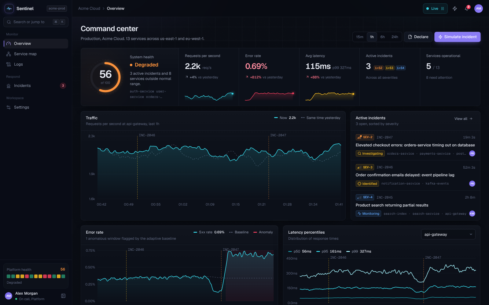
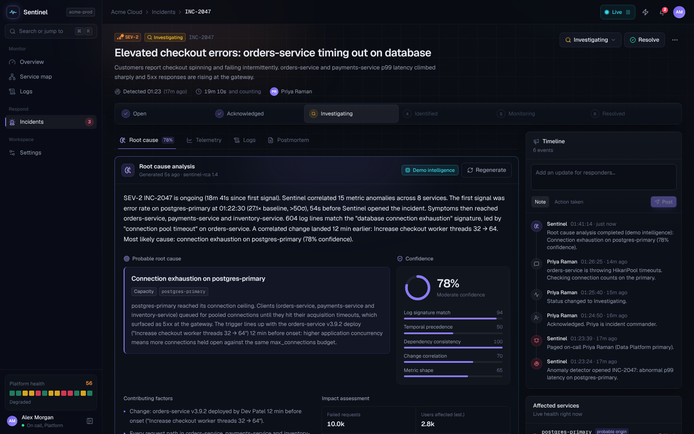
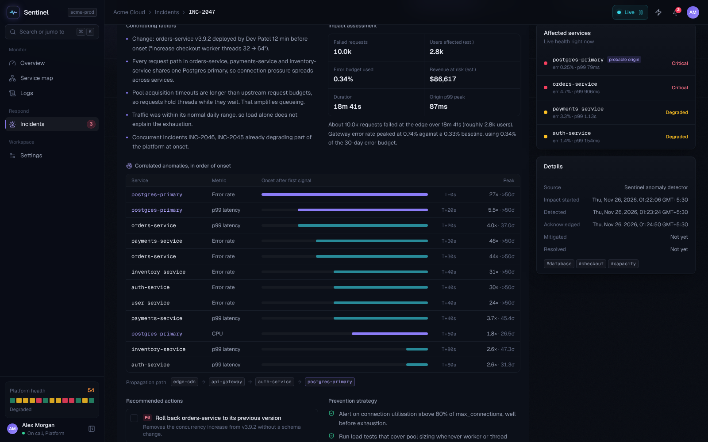
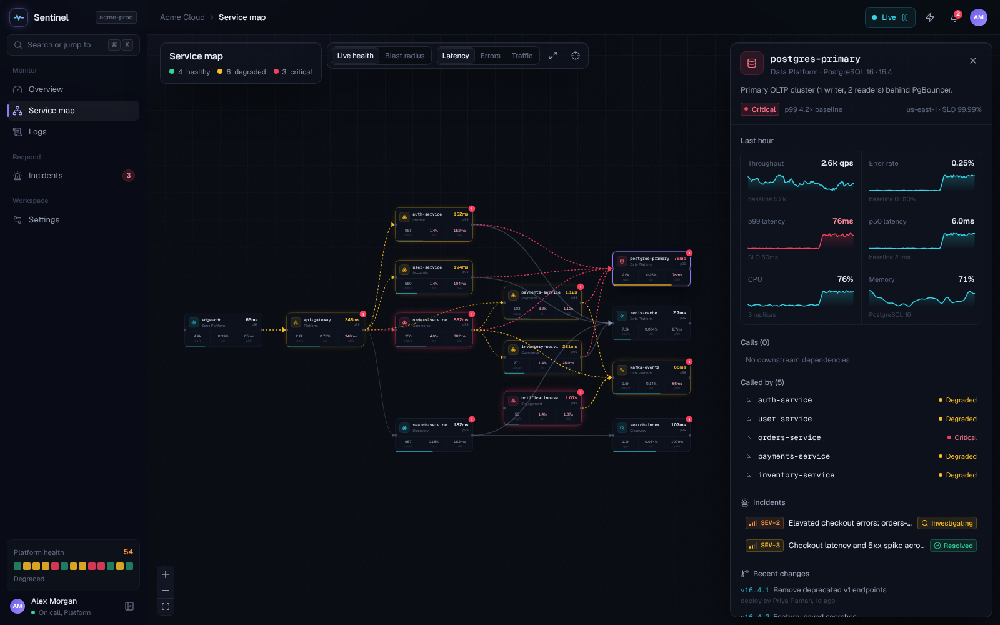
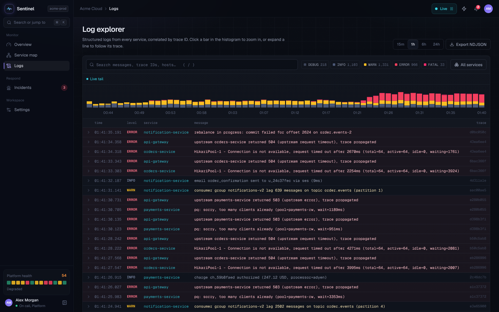
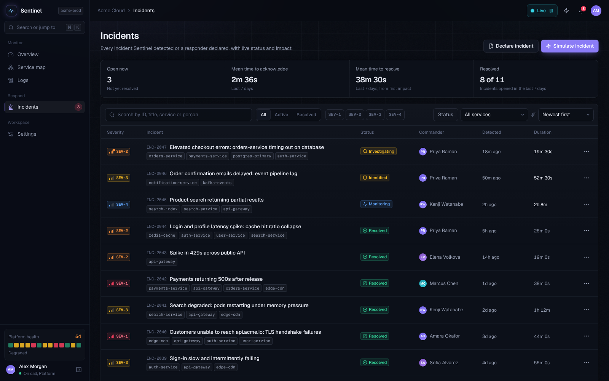
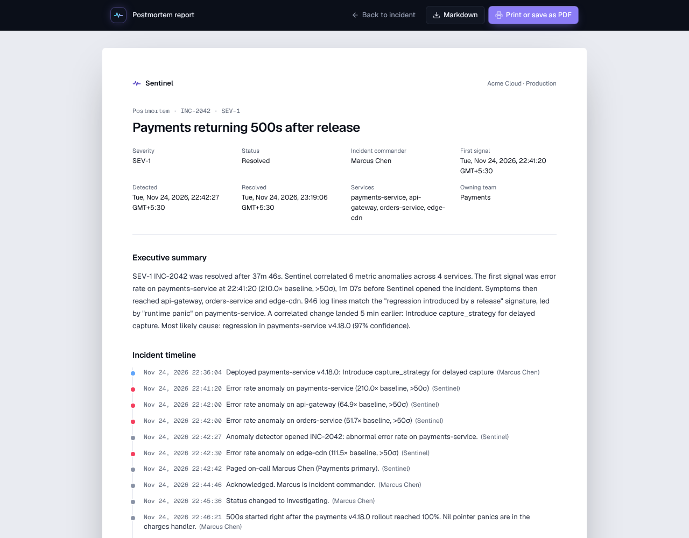
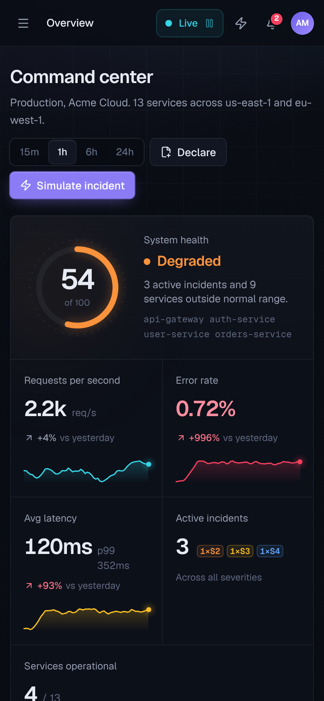
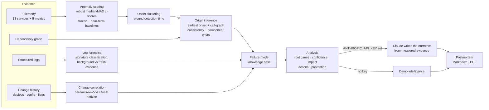
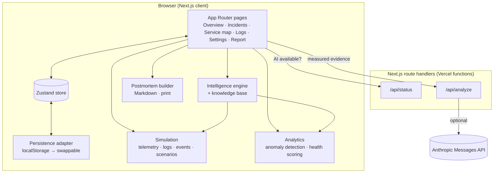

<div align="center">


# Sentinel

### See the signal. Stop the incident.

**AI-powered incident intelligence and observability platform**

Live telemetry · statistical anomaly detection · root-cause analysis · service dependency maps · structured logs · one-click postmortems




</div>

---

## Overview

Sentinel is a command center for on-call engineers. It watches a simulated production estate of **13 services** (edge, gateway, eight application services, Postgres, Redis, Kafka and OpenSearch), detects anomalies as they happen, opens incidents, and explains **what broke, why, how confident it is, and what to do next**.

The interesting part is the intelligence. Sentinel does not show canned AI text. A deterministic root-cause engine reads the same evidence an SRE would: metric anomalies scored against a baseline, the order in which services degraded, the dependency graph, log signatures and recent deploys. It then builds a hypothesis with a measured confidence score. When an Anthropic API key is configured, Claude writes the narrative **from that measured evidence**. Without a key, everything still works end to end.

> Every number in an analysis (anomalies, z-scores, failed requests, error-budget burn, confidence) is computed, never generated.

## Features

### Command center
- **System health score** (0–100), computed from per-service health, tier weighting and open incidents
- Live KPIs: requests per second, error rate, average latency, active incidents and services operational, with deltas against the same time yesterday
- **Traffic** with a "same time yesterday" comparison, **error rate** with anomaly bands from an adaptive baseline, and **latency percentiles** (p50, p95, p99) for any service
- Service health grid, live event feed (deploys, scaling, detections, recoveries), recent incident activity and the most affected services
- New telemetry every few seconds, with a **Live** indicator, **pause and resume**, and a **15m / 1h / 6h / 24h** time range selector

### Incident intelligence
- Incidents with ID, title, severity (SEV-1 to SEV-4), status, affected services, detection time, live duration, description and timeline
- Search, severity, status and service filters, sorting, and MTTA/MTTR stats
- **Acknowledge, change status, resolve, change severity**, post timeline notes and log actions
- **Declare incidents manually** (`N`) or **simulate a failure** (`⇧S`) from any of 10 realistic failure modes
- Clickable lifecycle stepper: Open → Acknowledged → Investigating → Identified → Monitoring → Resolved
- Resolving an incident makes the simulated telemetry recover; monitoring partially mitigates it

### Root-cause analysis (the star feature)
1. Executive summary
2. Probable root cause, with origin service and category
3. **Confidence score**, broken down into five independent evidence signals
4. Contributing factors
5. Impact assessment: failed requests, users affected, error budget, revenue at risk, duration
6. **Correlated anomalies** in onset order, with a propagation-lane view and dependency path
7. Recommended actions (P0/P1/P2), each of which can be checked off onto the timeline
8. Prevention strategy, including detection-lag and paging gaps found in this incident

Analyses stream in step by step with real counts ("Classified 2,421 log lines: 644 match known failure signatures…"), and every result is clearly labelled **AI-powered** or **Demo intelligence**.

### Service map
- Interactive dependency graph (React Flow) where nodes show health, throughput, error rate, p99 and CPU
- Unhealthy dependencies animate, so failure propagation is visible at a glance
- **Blast-radius mode** shows which services are impacted if a component fails, with hop distance
- A detail panel per service: live metrics, dependencies in and out, recent logs, incidents and changes

### Log explorer
- Structured logs from every service, with level, service and time filters plus full-text search
- Volume histogram by level; **click a bar to zoom into that window**
- Expandable entries with full JSON, errors highlighted, and **correlation IDs**: follow a trace across services in one click
- Live tail, deep links from incidents and services, and NDJSON export

### Postmortems
- One click generates: executive summary, timeline, root cause, business impact, resolution, what went well, what went wrong, and action items with owners and due dates
- **Download as Markdown** or copy it, or open the **print-friendly report** and save it as PDF from the browser

### Throughout
- Global **command palette** (`⌘K` / `Ctrl+K`) for incidents, services, navigation and actions
- Keyboard shortcuts, a notification center, toasts, onboarding tour, **chaos mode** and a **demo reset**
- Responsive down to mobile; respects `prefers-reduced-motion`, with an in-app reduce-motion setting

## Screenshots

| Root-cause analysis | Evidence and actions |
| --- | --- |
|  |  |
| **Service map** | **Log explorer** |
|  |  |
| **Incidents** | **Printable postmortem** |
|  |  |

<p align="center"></p>

> Regenerate these with `npm run build && npm start`, then `node scripts/screenshots.mjs http://localhost:3000`.

## How the intelligence works



- **Anomaly detection.** Each metric is scored with robust z-scores (median and MAD) against a frozen pre-incident baseline. A second pass against a near-term baseline catches a new failure stacking on top of a service that was already degraded. Minimum-run and relative-change floors suppress organic blips. The dashboard uses an adaptive rolling baseline that excludes anomalous points, so long incidents stay flagged.
- **Origin inference.** Failures propagate up the call graph with a per-hop delay. The engine scores each anomalous service on temporal precedence, how well the call graph explains the other anomalies (callers inherit errors and latency; callees see traffic shadows), and component-type priors.
- **Log forensics.** WARN/ERROR/FATAL lines are classified against failure-mode signatures and weighted by proximity to onset. Signatures that predate the onset are treated as background from another event, not evidence.
- **Confidence** is a weighted blend of five independent channels: log signature match, temporal precedence, dependency consistency, change correlation and metric shape.
- **Honesty.** The engine never reads the simulator's ground truth. `npm run verify:engine` simulates every failure mode, including analysis at the moment of detection and on top of concurrent incidents, and checks the diagnosis. Current result: **45/45**.

## Architecture



Telemetry is a **pure function of (service, time, incidents)**: baseline × diurnal load × organic noise, plus incident effects that ramp in, plateau and decay on mitigation or resolution. Charts, logs, the event feed and the RCA engine all read the same world, so a spike on the dashboard, the matching error logs and the analysis always agree. Only incidents, changes, notifications, analyses and settings are persisted.

```
src/
├── app/
│   ├── (console)/          # Overview, incidents, service map, logs, settings
│   ├── (print)/report/     # Print-friendly postmortem
│   └── api/                # /api/status, /api/analyze (Claude, optional)
├── components/
│   ├── ui/                 # Design-system primitives (Radix-based)
│   ├── shell/              # Sidebar, top bar, command palette, providers
│   ├── charts/             # Time series, sparklines, log histogram
│   ├── dashboard/          # Signal strip, health grid, feed, activity
│   ├── incidents/          # RCA panel, tabs, postmortem view, dialogs
│   ├── services/           # Service map node and detail panel
│   └── logs/               # Log row
└── lib/
    ├── catalog/            # Services, dependency graph, failure scenarios
    ├── sim/                # Telemetry, logs, feed, seed data, incident factory
    ├── analytics/          # Anomaly detection, health scoring
    ├── intelligence/       # RCA engine, knowledge base, Claude prompt/merge
    ├── persistence/        # Storage adapter
    ├── postmortem.ts       # Postmortem model + Markdown
    ├── store.ts            # Application state and actions
    └── types.ts
```

## Tech stack

| Area | Choice |
| --- | --- |
| Framework | Next.js 15 (App Router), React 19, TypeScript (strict) |
| Styling | Tailwind CSS v4, Geist Sans and Geist Mono, custom design tokens |
| UI primitives | Radix UI (dialog, popover, dropdown, tooltip, switch) in shadcn style, `cmdk` |
| Motion | Framer Motion |
| Charts and graphs | Recharts, React Flow (`@xyflow/react`), hand-rolled SVG sparklines |
| State | Zustand with a pluggable persistence adapter |
| AI | Anthropic Messages API (optional, server-side only) |
| Testing | `tsx` engine verification suite, Puppeteer end-to-end checks |

## Getting started

**Prerequisites:** Node.js 18.18+ (20+ recommended) and npm.

```bash
git clone https://github.com/<you>/sentinel-incident-intelligence.git
cd sentinel-incident-intelligence
npm install
npm run dev
```

Open http://localhost:3000. The workspace seeds itself with 11 incidents (three still active), a week of change history and live telemetry.

```bash
npm run build && npm start   # production build
npm run typecheck            # TypeScript
npm run verify:engine        # root-cause engine accuracy suite
npm run test:e2e             # browser workflows (needs a running app and Chrome; set CHROME_PATH)
```

## Environment variables

Copy `.env.example` to `.env.local`. **Everything is optional.**

| Variable | Default | Purpose |
| --- | --- | --- |
| `ANTHROPIC_API_KEY` | unset | Enables Claude-written analysis narratives. Server-side only; never sent to the browser. |
| `ANTHROPIC_MODEL` | `claude-sonnet-5-5` | Model used for narratives. |
| `NEXT_PUBLIC_SITE_URL` | `http://localhost:3000` | Canonical URL for metadata. |

If the key is missing, invalid or the API is unreachable, Sentinel falls back to demo intelligence and says so in the UI.

## Demo mode

- **Simulate an incident:** the ⚡ button, `⇧S`, or the command palette ("Simulate a specific failure" lists all 10 modes). Watch it appear on the dashboard, the service map, the logs and the event feed, then open it and let Sentinel diagnose it.
- **Resolve it:** the affected metrics recover over the next few minutes.
- **Chaos mode** (Settings) injects a random failure on an interval.
- **Reset demo data** (Settings, the account menu, or the command palette) restores the original dataset, re-anchored to the current time.

Failure modes: database connection exhaustion, bad release regression, cache eviction storm, Kafka replication and consumer lag, expired TLS certificate, memory leak and OOM restarts, rate-limit misconfiguration, third-party identity provider degradation, search hot shard, and row-lock contention.

## Keyboard shortcuts

| Keys | Action |
| --- | --- |
| `⌘K` / `Ctrl+K` | Command palette |
| `G` then `O` / `I` / `M` / `L` / `S` | Overview / Incidents / Service map / Logs / Settings |
| `N` | Declare an incident |
| `⇧S` | Simulate an incident |
| `P` | Pause or resume live telemetry |
| `[` | Collapse the sidebar |
| `/` | Focus search on the current page |
| `?` | Show all shortcuts |

## Deployment

### Vercel (recommended)

1. Push this repository to GitHub.
2. Import it at [vercel.com/new](https://vercel.com/new). The framework preset is detected automatically.
3. Optionally add `ANTHROPIC_API_KEY` under **Settings → Environment Variables**.
4. Deploy.

Or from the CLI:

```bash
npm i -g vercel
vercel            # preview
vercel --prod     # production
vercel env add ANTHROPIC_API_KEY
```

### Anywhere else

`npm run build && npm start` runs a standard Node server on port 3000 (`-p` to change it). There's no database to provision: the workspace lives in each visitor's browser.

## Extending to real data

The simulation sits behind small interfaces. To point Sentinel at production systems:

- Replace `lib/sim/telemetry.ts` series functions with queries to Prometheus, Datadog or CloudWatch (same `MetricPoint` shape).
- Replace `lib/sim/logs.ts` with your log store (Loki, Elasticsearch, CloudWatch Logs).
- Feed real deploy events into `changes`.
- Implement `KeyValueStore` in `lib/persistence/storage.ts` against an API or database to share incidents across a team.

The anomaly detection, root-cause engine, knowledge base and postmortem builder work unchanged.

## License

MIT
